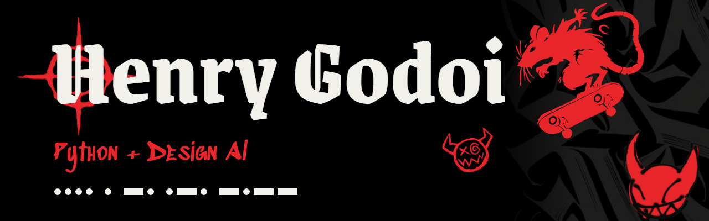
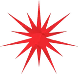
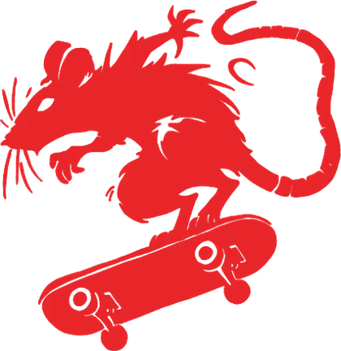
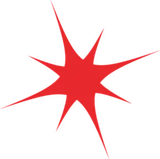
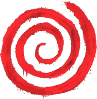
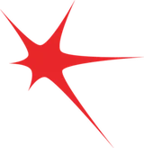
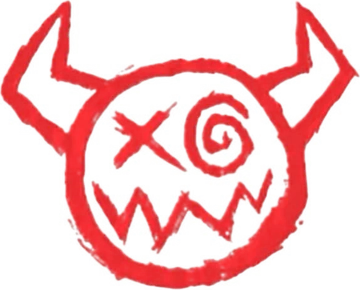

  

<h1 align="center">Olá, eu sou o Henry Godoi</h1>

<b>Estudante de Sistemas de Informação</b>

Procuro a minha primeira oportunidade no mercado de tecnologia, de preferência como desenvolvedor.

<h2 align="center"> Sobre mim</h2>

Estudo Sistemas de Informação na **Antonio Meneghetti Faculdade (AMF)**, em Santa Maria (RS), e trabalho como jovem aprendiz na área financeira da Marzari Alimentos.

Meu principal projeto é o **[Viaje Mais](https://github.com/HenryGodoi/Viaje-Mais)**, um PWA que vende com desconto as vagas que sobram em passeios da Quarta Colônia (RS). Com ele, a equipe foi campeã do **Ideathon 2026**.

Na faculdade, faço exercícios de **Python** em Algoritmos e projetos de **Arduino**, como dois Arduinos trocando mensagens em código Morse por infravermelho.

 

<h2 align="center"> Projetos em destaque</h2>

| Projeto | O que é | Tecnologias |
|---|---|---|
| [Viaje Mais](https://github.com/HenryGodoi/Viaje-Mais) | PWA que vende com desconto as vagas que sobram em passeios da Quarta Colônia (RS). Campeão do Ideathon 2026 | HTML, CSS, JavaScript, Node.js |
| [Estacionamento de aeronaves](https://github.com/HenryGodoi/Lab-De-Algoritmos-AMF/tree/main/Semana14) | Trabalho de Algoritmos: vagas, fila de espera, cobrança por diária e gráfico da ocupação | Python, matplotlib |

<h2 align="center"> Atividades de aula</h2>

- [Lab de Algoritmos](https://github.com/HenryGodoi/Lab-De-Algoritmos-AMF): exercícios de Python organizados por semana.
- [Código Morse por infravermelho](https://github.com/HenryGodoi/Trabalho_G2-Codigo_Morse): dois Arduinos trocando mensagens em Morse por luz infravermelha, com interface web.
- [Controle de processo com potenciômetros](https://github.com/HenryGodoi/A1---Henry), [portões com servo motor](https://github.com/HenryGodoi/Atividade-com-botoes) e [LED RGB com potenciômetros](https://github.com/HenryGodoi/RGB-e-Potenci-metros): exercícios de Arduino no Tinkercad.

<h2 align="center"> Tecnologias</h2>

  
  
  
  
  
  
  
  
  
  

<h2 align="center"> Trajetória</h2>

**Formação**
- Bacharelado em Sistemas de Informação, Antonio Meneghetti Faculdade (2026 - Em andamento).

**Experiência**
- Jovem aprendiz na área financeira da Marzari Alimentos (desde maio de 2026).

**Atividades**
- **Viagem técnica a Florianópolis (nov/2026):** visitas à ACATE, Aquarela Analytics, InPETU Hub, Instituto SENAI de Inovação em Sistemas Embarcados, Sapiens Parque, Audaces, CELTA e HostGator.
- **Ideathon 2026, AMF (out/2026):** campeão com o Viaje Mais.
- **CodeRace 2026, AMF (jun/2026):** hackathon de 18 horas com a equipe Cerberus. Atuei na pesquisa e na documentação do DryLeaf.

<h2 align="center"> Contato</h2>

  
  
  

henrygodoi4@gmail.com

